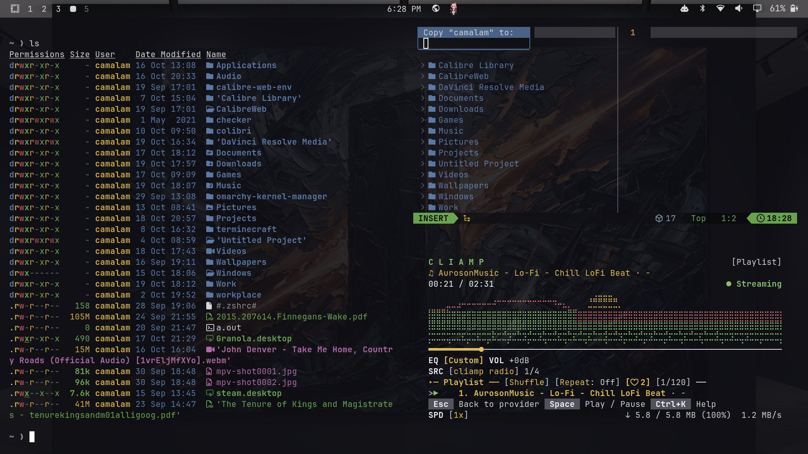

# Never Yield

A dark charcoal + gold theme for [Omarchy](https://omarchy.org) — a cold,
industrial dark theme with gold leaf highlights.



## Palette

Washed-out charcoal backgrounds with a copper-gold accent and brushed metal
grays.

| Role | Color | |
|------|-------|-|
| Background | `#0f0f14` |  |
| Foreground | `#d8d8d8` |  |
| Accent | `#c59043` |  |
| Selection | `#2a2a33` |  |
| Gold | `#d4af37` |  |

<details>
<summary>Full palette</summary>

| Role | Color |
|------|-------|
| Dark background | `#0a0a0e` |
| Darker background | `#050507` |
| Lighter background | `#1f1f28` |
| Muted | `#555560` |
| Red | `#b05050` |
| Orange | `#c59043` |
| Yellow | `#d4af37` |
| Green | `#6aa84f` |
| Cyan | `#8a9aab` |
| Blue | `#5a7aa8` |
| Magenta | `#b06aa8` |
| Brown | `#6b4f3f` |

</details>

## Install

```
omarchy theme install https://github.com/AcronixLabs/Never-Yeild.git
```

Installs as **never-yeild** in the theme picker (Omarchy menu → Install →
Style → Theme).

## What's included

- `colors.toml` — the palette, generating terminal, btop, Chromium, Hyprland,
  Neovim, Helix and Omarchy shell colors
- `icons.theme` — Papirus-Dark icon set
- `backgrounds/` — three charcoal-and-gold wallpapers
- `preview.png` — theme picker preview

## Credits

- Wallpapers generated with Gemini, by the theme author.
- Preview image: [Never Yield.jpg](Never%20Yield.jpg)

## License

MIT — see [LICENSE](LICENSE).
